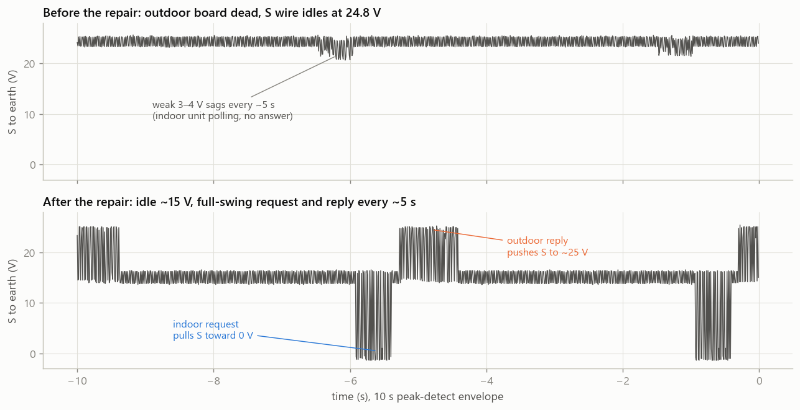
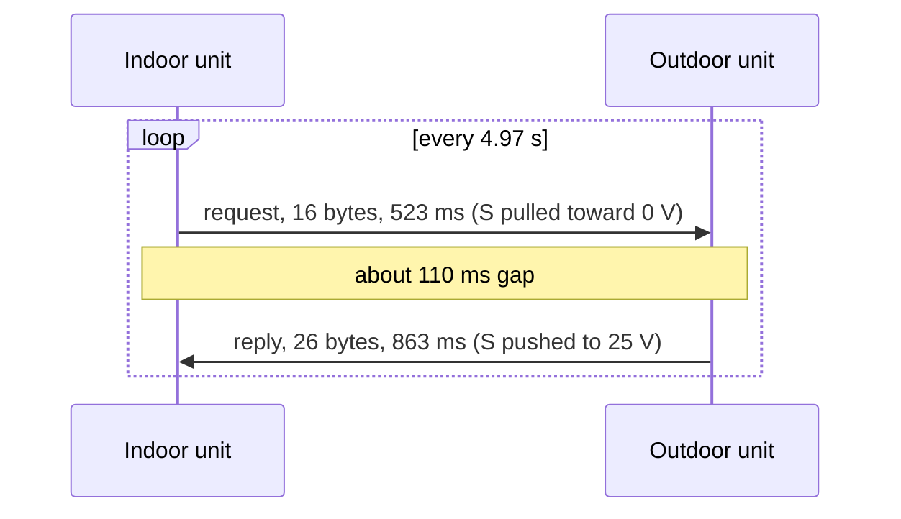
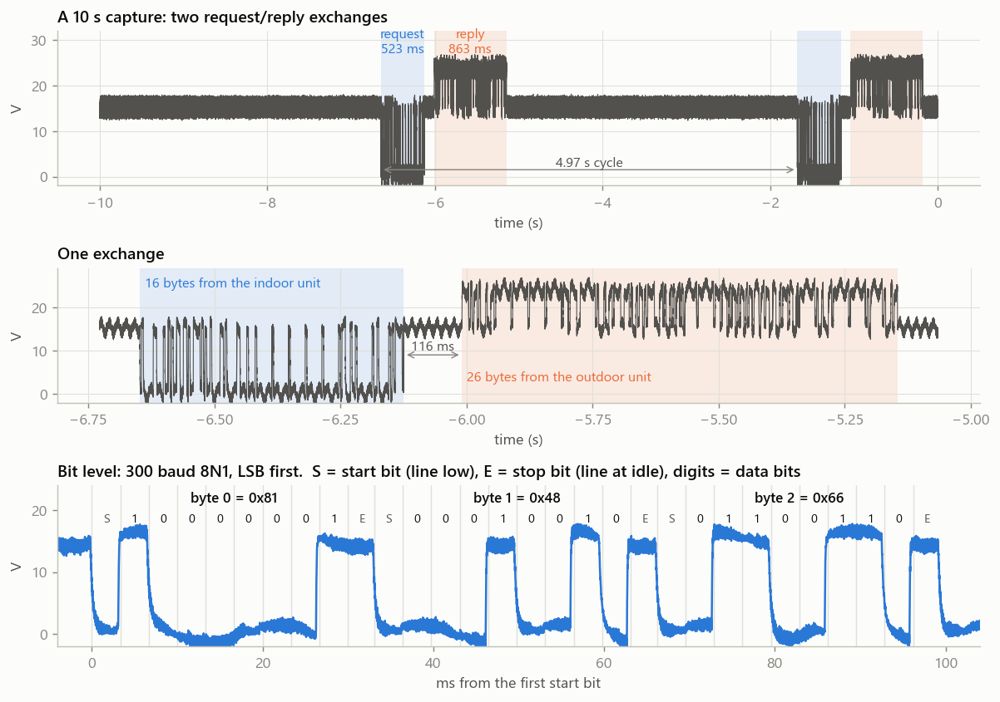
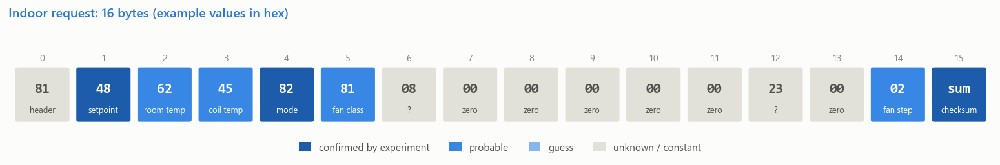
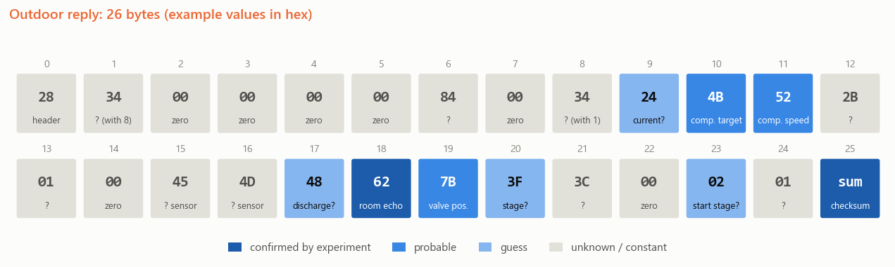
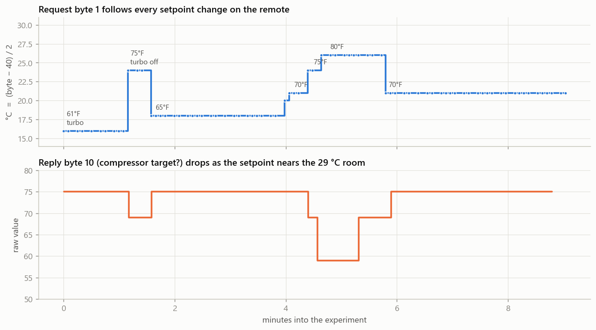
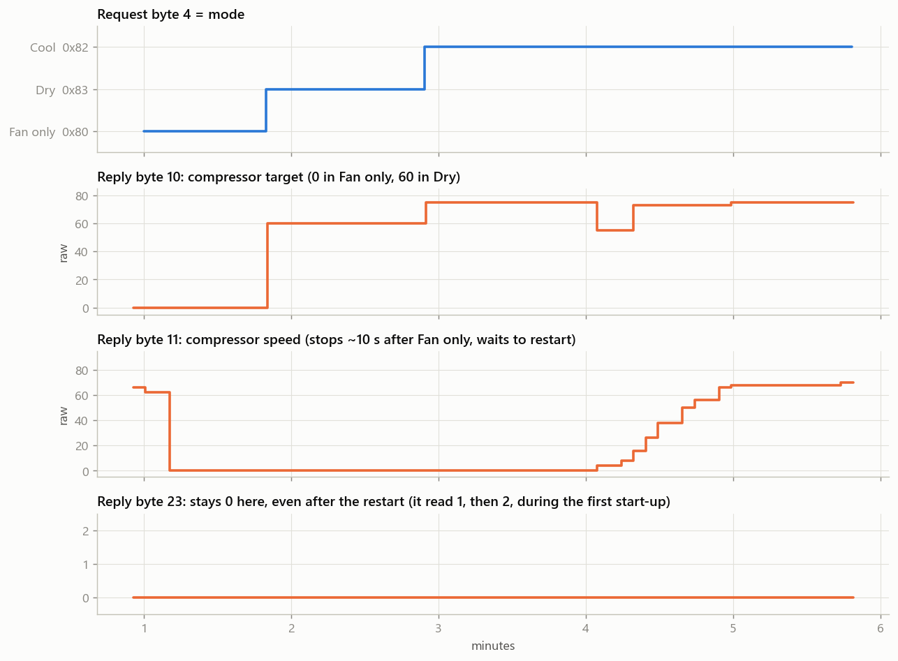
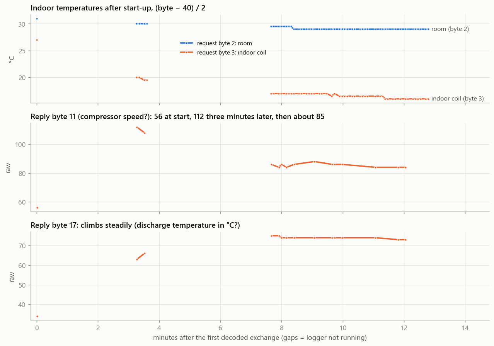

# Hessaire mini-split: indoor/outdoor bus protocol

A decode of the serial link between the indoor and outdoor units of a Hessaire ductless mini-split (Midea-built), captured with a Rigol DHO804 oscilloscope on 5 November 2026.

The link runs at **300 baud, 8N1**. Every 5 seconds the indoor unit sends a **16-byte request** and the outdoor unit answers with a **26-byte reply**. Each message ends in an **8-bit sum checksum**. Setpoint and mode are confirmed by controlled experiments with the remote. Several temperature, compressor and valve fields are probable but not yet checked against a reference instrument.

The work started as a fault hunt: the unit ran indoors but never cooled. The bus showed the indoor unit polling an outdoor unit that never answered. The cause was a broken wire to the reactor in the outdoor unit, so the outdoor board had no DC bus. After the repair the outdoor unit answered and the unit cooled.

## Contents

- [The fault, seen on the bus](#the-fault-seen-on-the-bus)
- [Physical layer and timing](#physical-layer-and-timing)
- [Framing, checksum and encoding](#framing-checksum-and-encoding)
- [Indoor request: 16 bytes](#indoor-request-16-bytes)
- [Outdoor reply: 26 bytes](#outdoor-reply-26-bytes)
- [Evidence](#evidence)
- [Limits of this decode](#limits-of-this-decode)
- [Reproducing it](#reproducing-it)

## The fault, seen on the bus



| | Outdoor board dead | After the repair |
|---|---|---|
| S-wire idle level | 24.8 V, no loop current | about 15.3 V, loop current flowing |
| Traffic | weak 3–4 V sags every ~5 s, the same in off, idle and cool | full-swing request and reply every ~5 s |
| Error code on the indoor display | none | none |

Without an answer from the outdoor unit, the indoor unit kept polling and never showed an error. A dead S-wire idle at the open-circuit voltage, with no reply bursts, is the signature of an outdoor board that is not powered.

## Physical layer and timing

| Item | Value |
|---|---|
| Wiring | 4 wires: L, N, S, ground. S carries the data. |
| Reference | S is referenced to N and earth on this unit, so a probe from S to earth works. Check this on any other unit before probing: on many mini-splits the signal wire is referenced to a mains leg. |
| Idle (mark) | about 15.3 V |
| Indoor transmitting | pulls S toward 0 V for a 0 bit |
| Outdoor transmitting | pushes S up to about 25 V for a 0 bit |
| Serial format | UART, 300 baud, 8 data bits, no parity, 1 stop bit, least significant bit first |
| Request length | 16 bytes, 523 ms |
| Reply length | 26 bytes, 863 ms |
| Gap, request end to reply start | about 110–116 ms |
| Cycle | one request/reply pair every 4.97 s |





The bottom panel shows the first three request bytes decoded bit by bit: `81`, `48`, `66`.

## Framing, checksum and encoding

- **Checksum.** The last byte of each message is the sum of all the bytes before it, modulo 256. Every decoded frame used in this report passes it.
- **Checksum blind spot.** A plain 8-bit sum misses some multi-bit errors. One captured reply had bit 7 flipped in four bytes, adding 4 × 0x80 = 0x200, which is 0 modulo 256, so the checksum still passed. The analysis therefore also drops any frame that breaks a byte that is constant in every other frame. That removed 2 of 253 replies.
- **Temperatures** use the common Midea form **°C = (byte − 40) / 2**, in half-degree steps. This is confirmed on the setpoint byte and fits the room and coil bytes.

## Indoor request: 16 bytes



| Byte | Values seen | Meaning | Evidence | Confidence |
|---|---|---|---|---|
| 0 | `81` | header or address | never changes | constant |
| 1 | `48`–`5C` | **setpoint**, (b − 40)/2 °C | follows every remote change, see [setpoint](#setpoint) | confirmed |
| 2 | `5E`–`66` | room (return-air) temperature, (b − 40)/2 °C | 31 °C at start, slowly down to 29 °C; echoed in reply byte 18 | probable |
| 3 | `3A`–`5E` | indoor coil temperature, (b − 40)/2 °C | 27 °C at start, falls to about 9–15 °C while cooling, rises when the compressor stops | probable |
| 4 | `80` `82` `83` | **mode**: `82` Cool, `80` Fan only, `83` Dry | follows the mode button, see [modes](#modes) | confirmed |
| 5 | `81`–`A1` | fan class in the low two bits; bit 5 set for one poll as turbo ended | changes together with byte 14 | probable |
| 6 | `08` | unknown | never changes | constant |
| 7–11 | `00` | unused | always zero | constant |
| 12 | `23` | unknown | never changes | constant |
| 13 | `00` | unused | always zero | constant |
| 14 | `01`–`07` | indoor fan speed step, as actually run (Auto chooses it) | 2 = High, 4 = lowest and Dry; 1, 3, 6, 7 at other steps | probable |
| 15 | | checksum | sum of bytes 0–14 | confirmed |

The first request captured after the repair:

```
81 48 66 5E 82 81 08 00 00 00 00 00 23 00 02 BD
```

## Outdoor reply: 26 bytes



| Byte | Values seen | Behaviour | Interpretation | Confidence |
|---|---|---|---|---|
| 0 | `28` | never changes | header or address | constant |
| 1 | `00`–`43` | moves together with byte 8 | unknown | unknown |
| 2–5 | `00` | always zero | unused | constant |
| 6 | `84` | never changes | unknown | constant |
| 7 | `00` | always zero | unused | constant |
| 8 | `00`–`42` | moves together with byte 1 | unknown | unknown |
| 9 | `00`–`27` | 24 at start, rose to 39 with the compressor, then about 35 | current? | guess |
| 10 | `00`–`4B` | 75 in Cool with a large room/setpoint gap, 69 at 24 °C, 59 at 26 °C, 0 in Fan only, 60 in Dry | compressor target speed | probable |
| 11 | `00`–`70` | 56 at start, 112 after 3 minutes, about 85 steady; 0 about 10 s after Fan only, ramped back after the restart delay | actual compressor speed | probable |
| 12 | `16`–`D5` | about 42 while running, jumps to about 163 when the compressor stops | unknown | unknown |
| 13 | `00`–`01` | | unknown | unknown |
| 14 | `00` | always zero | unused | constant |
| 15, 16 | `43`–`52` | slow drift | unknown sensors | unknown |
| 17 | `22`–`4B` | 34 at start, climbs to about 75 | discharge temperature in °C? | guess |
| 18 | `5E`–`66` | always equal to request byte 2 | echo of the room temperature | confirmed |
| 19 | `63`–`FA` | 100 at start, up to about 150 while running, jumped 179 / 250 / 118 / 100 when the compressor stopped | expansion-valve position (too fast for a temperature) | probable |
| 20 | `00`–`48` | 0 at start, stepped to about 63–65 | fan or valve stage? | guess |
| 21 | `39`–`3D` | jitters | unknown | unknown |
| 22 | `00` | always zero | unused | constant |
| 23 | `00`–`02` | 0, 1, 2 during the first start-up; stayed 0 after a later restart | start-up stage? | guess |
| 24 | `01` | never changes | unknown | constant |
| 25 | | checksum | sum of bytes 0–24 | confirmed |

The first reply captured after the repair:

```
28 37 00 00 00 00 84 00 37 18 4B 38 2B 01 00 44 4A 22 66 64 00 3B 00 00 01 97
```

## Evidence

### Setpoint

The remote was stepped through setpoints about 30 seconds apart while the bus was logged.



| Remote | Request byte 1 | (b − 40) / 2 | Reply byte 10 |
|---|---|---|---|
| 61°F, turbo | `48` | 16 °C | 75 |
| 75°F, turbo off | `58` | 24 °C | 69 |
| 65°F | `4C` | 18 °C | 75 |
| 70°F | `52` | 21 °C | 75 |
| 75°F | `58` | 24 °C | 69 |
| 80°F | `5C` | 26 °C | 59 |
| 70°F | `52` | 21 °C | 75 |

The remote converts Fahrenheit to whole degrees Celsius before sending. In Dry mode the setpoint byte tracks the room temperature at room − 2 °C.

### Modes



| Mode | Request byte 4 | Reply byte 10 | Compressor (reply byte 11) |
|---|---|---|---|
| Cool | `82` | 75 | runs |
| Fan only | `80` | 0 | stops within about 10 s |
| Dry | `83` | 60 | stays off during the restart delay |
| Heat | not captured | | |

### Fan speed

The fan steps were changed faster than the 5-second poll, so only some steps were captured:

| Setting | Request byte 5 | Request byte 14 |
|---|---|---|
| Turbo ending, one poll | `A1` | 1 |
| High | `81` | 2 |
| Auto, room far above setpoint | `81` | 2 |
| Auto, smaller gap | `82` | 4 |
| Intermediate steps | `83`, `83`, `82` | 3, 6, 7 |
| Lowest, and Dry | `82` | 4 |

On Auto, byte 14 changed by itself as the room cooled, so it seems to report the speed the indoor fan actually runs rather than the button setting.

### Start-up



## Limits of this decode

- **Confidence levels.** *Confirmed* means a controlled change on the remote moved the byte as predicted. *Probable* means the byte behaves the way the named quantity must. *Guess* means a plausible match with weak evidence. *Unknown* means no interpretation yet.
- **No reference instruments.** Room, coil, discharge and current readings were not compared against a thermometer or clamp meter, so their scaling is inferred.
- **One unit, one firmware.** Other Midea-built units can use different buses entirely. Senville units, for example, use a 4800-baud bus with CRC-16 frames.
- **Not yet captured:** Heat mode, the remote labels for fan steps 3, 6 and 7, defrost, and error states.
- **Listen only.** Nothing was ever transmitted on the bus. Injecting frames could confuse both boards.

## Reproducing it

Hardware: a Rigol DHO804, with a 10× probe on channel 1, the tip on the S terminal and the ground clip on earth. Power the unit off while connecting, and confirm first that S is not mains-referenced on your unit.

```
pip install numpy matplotlib
export DHO_IP=<scope address>               # Windows: set DHO_IP=<scope address>
python tools/bus_logger.py 5 "my note"      # log decoded frames for 5 minutes into data/bus_log.jsonl
python tools/bus_analyze.py "my note"       # per-byte summary and figures/bus_bytes.png
python tools/make_figures.py                # regenerate the figures in this README
```

| File | Purpose |
|---|---|
| `tools/dho_scpi.py` | SCPI client for the DHO804. Reads the full record even though the scope's waveform header reports 22,000 points. |
| `tools/uart_decode.py` | UART decoder with majority-vote bit sampling |
| `tools/bus_logger.py` | 10-second roll-mode captures, decode, checksum check, append to the log |
| `tools/bus_analyze.py` | per-byte constancy, ranges and trends |
| `tools/make_figures.py` | the figures in this README |
| `data/bus_log.jsonl` | 684 decoded frames (557 pass the checksum): time in seconds after the first frame, note, bytes, checksum status |
| `data/exchange_10s.npz` | one 10-second S-wire capture, 10 µs samples, in mV |
| `data/envelope_*.npz` | 10-second peak-detect envelopes before and after the repair |

Scope notes for the DHO804 with NKmod 04.2 firmware:

- At 50 ms/div and slower the scope switches to roll mode, which ignores the trigger. Use 20 ms/div or faster for triggered captures.
- The memory-depth list is shifted one step: requesting 10M gives 1M points.
- Repeated 5-million-point, 16-bit reads in roll mode crashed the scope app once. The logger uses 1-million-point, 8-bit reads.
